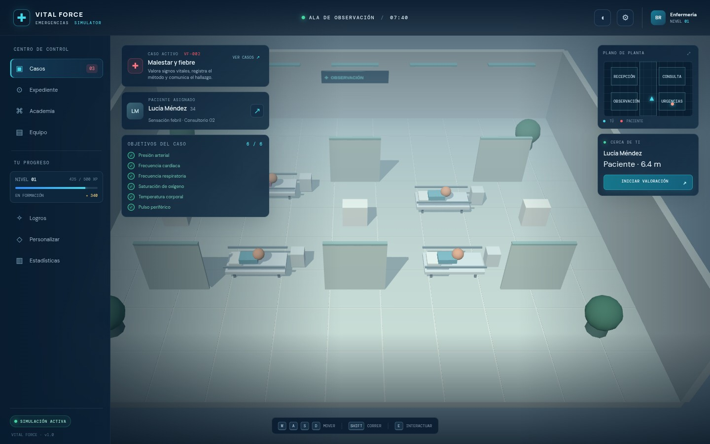
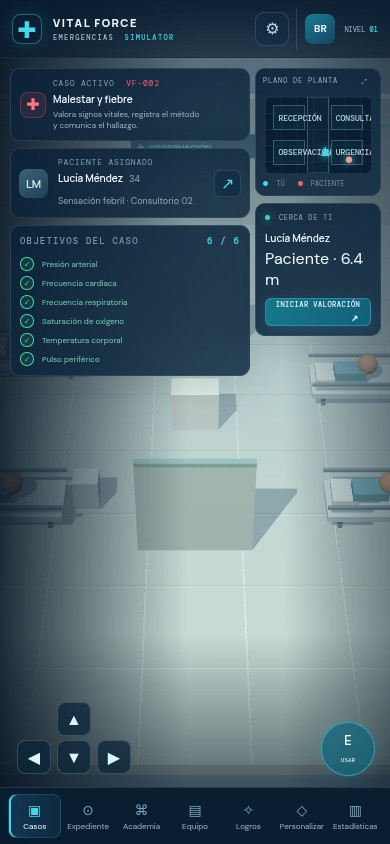

# VITAL FORCE: EMERGENCIAS

Simulador hospitalario educativo en 3D, creado por **Brandon Ramos CHLO**. Explora un hospital ficticio, practica secuencias guiadas de valoración y registra signos vitales en casos simulados.

> **Aviso educativo:** este videojuego no es una herramienta médica, no diagnostica ni ofrece tratamiento o triaje. Su contenido no sustituye formación acreditada, supervisión profesional ni protocolos locales. Los casos, pacientes y resultados son ficticios. Ante una emergencia real, contacta con los servicios de emergencia de tu zona.

## Requisitos

- Node.js 20.19+ o 22.12+ (requisito de Vite 7).
- Navegador moderno con WebGL habilitado.

## Instalación y ejecución

```bash
npm install
npm run start
```

Abre en el navegador la dirección local que indique Vite (normalmente <http://localhost:5173>). Para generar la versión de producción:

```bash
npm run build
```

El resultado se genera en `dist/`. Para probar esa compilación localmente, puedes ejecutar `npx vite preview` después de construirla.

## Cómo jugar

- **Escritorio:** muévete con `W`, `A`, `S`, `D` o las flechas. Mantén `Shift` mientras te mueves para correr. Acércate a una cama y pulsa `E` para interactuar. `Esc` cierra la ventana abierta.
- **Móvil o pantalla táctil:** usa la cruceta en pantalla para moverte y el botón **USAR** para interactuar. Los paneles y procedimientos se manejan con controles táctiles.
- Elige un caso desde **Casos**. En **Expediente**, selecciona cada medición y avanza por sus pasos educativos para registrar los seis signos vitales.
- Consulta **Academia** para repasar conceptos y responder preguntas. **Equipo**, **Logros**, **Personalizar**, **Estadísticas**, **Configuración** y el **Plano de planta** reúnen las demás opciones de la interfaz.

## Alcance y límites

- Incluye cuatro casos ficticios, un hospital explorable construido con geometría procedural, secuencias educativas de toma de signos vitales, preguntas de repaso y progreso de juego.
- Las lecturas son valores predeterminados de cada caso: no se miden desde el dispositivo ni representan datos de una persona real. Las interpretaciones son orientación general para el juego, no criterios diagnósticos ni protocolos clínicos.
- La exploración, las mediciones registradas, los casos completados, la academia y las preferencias se guardan automáticamente en el almacenamiento local del navegador. El guardado es por dispositivo y navegador; no hay cuenta ni sincronización en la nube. **Reiniciar progreso** en Configuración elimina esos datos locales.
- La opción de sonido es solo una preferencia de interfaz: esta versión no reproduce audio. La personalización cambia el color de acento y se desbloquea con fichas del juego.
- Se requiere WebGL. El rendimiento y la disponibilidad pueden variar según el navegador y el dispositivo.

## Capturas

**Escritorio (1440 × 900)**



**Móvil (390 × 844)**



## Tecnologías

- [Three.js](https://threejs.org/) para la escena 3D procedural.
- [Vite](https://vite.dev/) para el entorno de desarrollo y la compilación.

---

**Creado por Brandon Ramos CHLO.**
